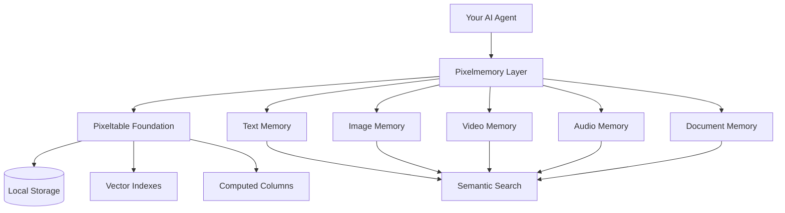
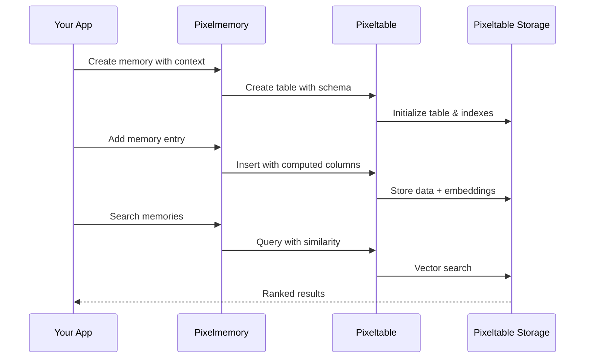

# Pixelmemory

**Reference Implementation: Multimodal Memory Layer Built on [Pixeltable](https://github.com/pixeltable/pixeltable)**

[](https://opensource.org/licenses/Apache-2.0)
[](https://pypi.org/project/pixelmemory/)
[](https://discord.gg/QPyqFYx2UN)

## Overview

Pixelmemory demonstrates how to build sophisticated memory layers using [Pixeltable's](https://github.com/pixeltable/pixeltable) declarative data infrastructure. This reference implementation shows how to create persistent, searchable, multimodal memory for stateful AI agents.



## Why Use Pixelmemory?

Most AI applications today are stateless - they forget everything between sessions. Pixelmemory solves this by providing:

- **Persistent memory** that survives between sessions
- **Semantic search** across all data types  
- **Local-first storage** with no vendor lock-in
- **Multimodal support** for text, images, videos, audio, documents
- **Production-ready** foundation built on Pixeltable

## Installation

```bash
pip install pixelmemory
```

Python 3.11+ is required. Pixelmemory 0.2.0 uses Pixeltable 0.7.17+ (below
0.8) and sentence-transformers 5.4+. Both are installed automatically. The
default local embedding model downloads its weights on first use.

Install the extras for the contexts you use:

| Context | Additional setup |
| --- | --- |
| Text, Document | None for direct text search and token-based document chunks |
| Text with `use_chunking=True` | `pip install 'pixelmemory[sentence]'`, then `python -m spacy download en_core_web_sm` |
| Image | `pip install 'pixelmemory[openai]'` and `OPENAI_API_KEY`, or `pixelmemory[anthropic]` and `ANTHROPIC_API_KEY` |
| Audio, Video | `pip install 'pixelmemory[openai,sentence]'`, `OPENAI_API_KEY`, and `python -m spacy download en_core_web_sm` |

Video uses OpenAI transcription even when frame captions use Anthropic. Add
the `anthropic` extra and key for that configuration. `use_clip=True` also
requires a compatible `torchvision` installation and downloads CLIP weights.
Document splitting with `separators="sentence"` needs the same sentence setup.

## Quick Start

```python
from pixelmemory import Memory
from pixelmemory.context import Text

# Define memory structure
context = [
    Text(id="content", embed=True),    # Searchable content
    Text(id="user_id", embed=False),   # Metadata
]

# Create memory instance
memory = Memory(context=context, namespace="chatbot")

# Add memories
entry = memory.Entry(content="I love Python programming", user_id="user_123")
memory.add(entry)

# Semantic search
results = memory.search("programming languages", min_score=0.5)
for r in results:
    print(r["score"], r["text"])
```

`search()` returns `context_id`, `text` and `score`. It searches text columns,
document chunks, transcripts and image/frame captions. Use `memory.views()`
and raw Pixeltable queries when you need source metadata or a CLIP index.

## Architecture



## Examples

### Basic Text Memory
```python
from pixelmemory import Memory
from pixelmemory.context import Text

context = [Text(id="content", embed=True)]
memory = Memory(context=context)

# Add and search
entry = memory.Entry(content="Learning about AI")
memory.add(entry)

# Semantic search
results = memory.search("artificial intelligence", min_score=0.3)
```

### Multimodal Memory
```python
from pixelmemory.context import Text, Image, Video

# Support multiple data types
context = [
    Text(id="description", embed=True),
    Image(id="screenshot", provider="openai", model="gpt-4o-mini"),
    Video(id="demo_video"),
]

memory = Memory(context=context, namespace="multimodal_app")
```

### Integration with LangChain
```python
from pixelmemory import Memory
from pixelmemory.context import Text
from langchain.chat_models import init_chat_model

# Persistent chat memory
context = [
    Text(id="session_id", embed=False),
    Text(id="messages", embed=False),
]

memory = Memory(context=context, namespace="langchain_chat")
model = init_chat_model("gpt-4o-mini", model_provider="openai")

# Chat with memory
def chat_with_memory(session_id: str, message: str):
    # Retrieve history, generate response, save back to memory
    # (See examples/integrations/langchain_chat_history.py)
    pass
```

## Example Files

All examples use the context-based API and are ready to run:

**Basic Examples** (local embedding model; no provider key):
- `examples/getting_started/01_basic_memory.py`
- `examples/multimodal/text.py`

**Multimodal Examples** (require OpenAI API key):
- `examples/multimodal/images.py`
- `examples/multimodal/video.py`
- `examples/multimodal/audio.py`

**Integration Examples**:
- `examples/integrations/langchain_chat_history.py` (requires OpenAI API key)
- `examples/integrations/crewai_agentic_rag.py` (requires `pip install crewai`)
- `examples/fastapi/memory_service.py` (requires `pip install fastapi uvicorn`)
- `examples/mcp/memory.py` (requires `pip install 'mcp>=2.3'`; serves task tools over Streamable HTTP)


## Next Steps

**Ready to build more advanced AI applications?**

1. **[Explore Pixeltable](https://github.com/pixeltable/pixeltable)** - Master the underlying infrastructure
2. **[Read the documentation](https://docs.pixeltable.com/)** - Comprehensive guides and tutorials  
3. **[Join the community](https://discord.gg/QPyqFYx2UN)** - Get help and share your implementations
4. **[See advanced examples](https://docs.pixeltable.com/docs/examples/use-cases)** - RAG, computer vision, audio processing

**Learn more about building stateful agents**: [Building Memory-Powered AI: Creating Stateful Agents with Pixeltable](https://www.pixeltable.com/blog/building-memory-powered-ai-stateful-agents-pixeltable)

---

**Remember**: Pixelmemory is a reference implementation. Use it as inspiration to build your own memory architecture using [Pixeltable's](https://github.com/pixeltable/pixeltable) flexible primitives.

## Migrating from 0.1.x

0.2.0 requires Python 3.11+ and Pixeltable 0.7.17+. It introduces a
context-based API. After the release is published, upgrade with
`pip install -U pixelmemory`.

### From the published 0.1.0 package

The 0.1.0 wheel on PyPI has a conversation-only API. Its constructor, insertion
arguments and search result format differ from 0.2.0:

| Published 0.1.0 | 0.2.0 |
| --- | --- |
| `Memory()` or `Memory(embedding_model="...")` | `Memory(context=[Text(id="content", embed_model="...")], namespace="user_123_memory")` |
| `memory.add(messages, user_id="user_123")` | `memory.add(memory.Entry(content=conversation))` |
| `memory.search(query, user_id="user_123")["results"]` | `memory.search(query)` returns a list; use a separate namespace for each user |
| Result keys `memory` and `similarity` | Result keys `text` and `score`, plus `context_id` |

For example, to store the same conversation text:

```python
from pixelmemory import Memory
from pixelmemory.context import Text

memory = Memory([Text(id="content")], namespace="user_123_memory")
messages = [{"role": "user", "content": "I enjoy programming."}]
conversation = " ".join(f"{m['role']}: {m['content']}" for m in messages)
memory.add(memory.Entry(content=conversation))
for result in memory.search("programming"):
    print(result["text"], result["score"])
```

Existing `pixelmemory_<user_id>` tables remain separate; 0.2.0 does not
automatically import their rows. Export or back up their `timestamp`, `memory`
and `metadata` columns through Pixeltable before migrating data into a new
namespace. Declare additional contexts if you want to retain those fields;
use raw table/view queries to retrieve source metadata alongside search hits.

### From the unreleased context-based repository API

If you installed the repository rather than the PyPI wheel, the context API
was already present. Its Document, Audio and Video pipelines used removed
Pixeltable iterator arguments. The relevant changes are:

- **Python 3.11+ is required.** Pixeltable dropped 3.10 in 0.7.2.
- **Two splitter parameter dataclasses are renamed.** `AudioSplitterParams`
  takes `duration` / `overlap` / `min_segment_duration` (was
  `chunk_duration_sec` / `overlap_sec` / `min_chunk_duration_sec`), and
  `DocumentSplitterParams` takes `skip_tags` (was `html_skip_tags`). These
  names are passed straight through to Pixeltable's iterators, so they are the
  API rather than a naming choice, and the old ones were the bug.
- **`memory.chunk_views[...]` and `memory.frame_views[...]` are replaced by
  `memory.search()` and `memory.views()`.** Nothing breaks in practice:
  `chunk_views` is a list on `resources`, not a mapping on `Memory`, so those
  subscripts always raised `AttributeError`.

```python
# before -- raised AttributeError
chunk_view = memory.chunk_views["report"]
sim = chunk_view.text.similarity(query)
results = (chunk_view.order_by(sim, asc=False).limit(3)
           .select(chunk_view.text, similarity=sim).collect())

# after
results = memory.search(query, on="report", limit=3)
```

For that repository API, `Memory(...)`, `memory.Entry`, `memory.add()` and the
attribute passthrough keep the same shape. Use `required=False` for a nullable context; its Entry field
can be omitted and defaults to `None`. Optional contexts can also be embedded.

Embedding index names are scoped to each context so multiple embedded fields
work together. Existing legacy indexes are reused. For a raw Pixeltable query,
read the index name from `memory.search_targets` instead of assuming
`"similarity"`; `memory.search()` selects it for you.

One behaviour change worth knowing: views and indexes now survive
reconstruction. Building the same `Memory` twice used to drop and rebuild
every view and index, re-running transcription and re-embedding everything.

Reopen a memory with the same context configuration. Reopening does not update
existing computed expressions, splitter settings or embedding models. Use
Pixeltable's explicit schema/index APIs for those changes, or a new namespace;
`if_exists="replace_force"` deletes the existing table and dependent views.

## Development and verification

```bash
uv sync --locked --python 3.12
uv run ruff check .
uv run python -m pytest
uv build
```

Tests use an isolated catalog and remove provider credentials. They cover real
Pixeltable inserts, search, reconstruction, and multimodal iterators. Provider
responses are simulated in multimodal tests; text ranking also runs a real
local sentence-transformers model. Sentence tests use spaCy's local sentencizer
without downloading the English model. Live provider compatibility requires
separate credentialed testing.

CI tests the locked dependencies on Python 3.11–3.13 and an unpinned Pixeltable
canary on Python 3.12. The release workflow verifies the installed wheel from
outside the source tree before publishing. See [RELEASING.md](RELEASING.md).

## When not to use pixelmemory

If your memory schema is fixed when you write the code, you do not need a
wrapper. Declare it directly with Pixeltable's `TableModel` and
`FastAPIRouter` and run `pxt schema update` / `pxt service update`; the
[starter kit](https://github.com/pixeltable/pixeltable-starter-kit) has
working apps in that shape.

pixelmemory earns its keep when the schema is chosen at **runtime** -- when
the `Context` list comes from a config file or a request -- and for the
multimodal ingest pipelines it wires up for you: audio to segments to
transcription to sentences to embeddings, and video to frames plus captions,
in the right dependency order.


## License

Apache 2.0 License
